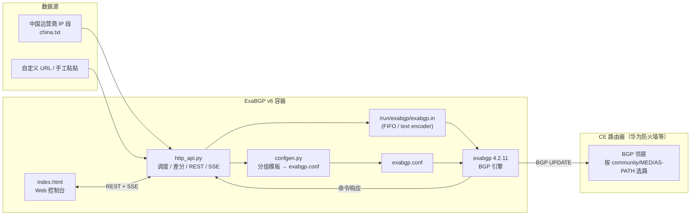
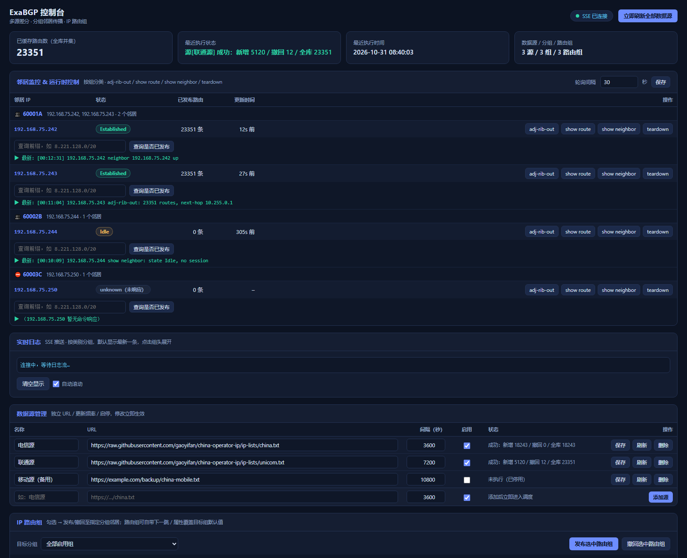

<div align="center">


# ExaBGP 路由管理引擎

**多源采集 · 分组传播 · 可视化下发 · 为 BGP 选路而生的路由注入平台**

[](v6/http_api.py)
[](v6/Dockerfile)
[](v6/index.html)
[](docs/deployment.md)

</div>

---

## 这是什么

把**区域 / 国家 IP 段**从多个数据源采集下来，按客户/站点分组打上 `community`、`MED`、`AS-PATH prepend` 等路由属性，通过 ExaBGP 播给 CE 路由器，用于**出口选路、主备切换与流量调度**。

> Own your egress routing: collect regional/country IP prefixes from multiple feeds, tag them with BGP attributes (community / MED / AS-PATH prepend), and announce them to your CE routers — with a real-time web console.

引擎只负责 **"打标 + 送过去"**，真正的路径判定交给 CE（BFD / GRE / 主备倒换都在下级设备完成），职责边界清晰，故障面小。

## 核心特性

| 能力 | 说明 |
|---|---|
| **多数据源** | 每个源独立 URL、独立更新频率（10s~86400s）、独立启停；各自维护路由集合与磁盘快照，重启自愈 |
| **增量差分** | 首次全量、之后按集合差只发变化；撤回前检查其他源是否仍覆盖，避免误撤 |
| **分组传播** | 一个"分组"= 一组邻居 IP + 下一跳 + 属性，可逐组覆盖 `local-as / peer-as / local-address / router-id` |
| **IP 路由组** | 手工粘贴或从 URL 导入前缀集合，勾选后批量发布/撤回，可整体覆盖下一跳/属性 |
| **选路属性** | `community`、`MED`、`AS-PATH prepend`（按组或路由组覆盖），详见 [选路属性指南](docs/routing-attributes.md) |
| **配置热重载** | 分组变更 → 重新渲染 `exabgp.conf` → 通过 API `reload` 热加载，**不断邻居会话** |
| **可视化控制台** | 邻居状态、adj-rib-out 查询、实时日志（SSE）、数据源/路由组/分组在线增删改、手动发布 |
| **可观测** | 命令回显（`show adj-rib out` 等）、按前缀查询"是否已发布"、运行时参数快照、按天滚动日志 |

## 架构



- **控制面**：`http_api.py` 负责拉取、差分、下发；`confgen.py` 只负责把"分组配置"渲染成 `exabgp.conf` 的 `neighbor` 声明块。
- **数据面**：exabgp 作为 PID 1 持有 BGP 会话，引擎通过 FIFO 用文本命令注入/撤回路由。
- **持久化**：全部落在 `/exabgp/data` 卷里，容器重建不丢配置与快照。

更细的设计取舍见 [架构说明](docs/architecture.md)。

## 控制台



KPI 概览 · 邻居监控（含逐邻居命令与回显）· 实时日志 · 数据源 · IP 路由组 · 分组传播 · 手动发布 · 运行时参数快照。

## 快速开始

```bash
# 1) 构建镜像
git clone https://github.com/TaylorGotIT/ExaBGP.git && cd ExaBGP
docker build -t exabgp:v6 ./v6

# 2) 启动（--network host 是必须的：BGP 179 + 控制台 9550 + exabgp FIFO）
docker run -d --name exabgp-v6 --network host \
  -v /exabgp/data:/exabgp/data \
  -e TZ=Asia/Shanghai \
  -e LOCAL_AS=65000 -e PEER_AS=65001 \
  -e NEXT_HOP=192.168.75.244 -e TARGET_NEIGHBOR=192.168.75.241 \
  -e REFRESH_INTERVAL=300 \
  --restart unless-stopped \
  exabgp:v6

# 3) 打开控制台
#    http://<宿主机IP>:9550/index.html
```

首次启动会用环境变量生成默认的"数据源 + 分组"；之后所有变更都在控制台完成，并持久化到 `/exabgp/data/runtime_config.json`。

完整部署（裸机 / systemd / 多实例 / 时区 / 备份）见 [部署指南](docs/deployment.md)。

## 常用操作

| 想做什么 | 在哪做 |
|---|---|
| 换数据源、调更新频率 | 控制台「数据源管理」，或 `POST /api/sources` |
| 新增一个客户/站点分组 | 控制台「分组邻居传播」，填组名 + 邻居 IP + 下一跳 + community |
| 批量发布一批网段 | 控制台「IP 路由组」→ 勾选 → 发布选中路由组 |
| 给某组打主备标记 | 分组/路由组的 `MED`、`Prepends` 两列 |
| 查某前缀是否已发布 | 邻居行内的"查询前缀"输入框，或 `GET /api/adjrib?ip=&prefix=` |
| 看邻居/路由表 | 邻居行的 `adj-rib-out / show route / show neighbor / teardown` 按钮 |

## 目录结构

```
.
├── README.md                    # 项目主页（本文件）
├── assets/                      # 徽标与图标（SVG 源文件 + 多尺寸 PNG）
├── docs/                        # 文档
│   ├── architecture.md          # 架构与设计取舍
│   ├── deployment.md            # 部署指南（Docker / 裸机 / 多实例）
│   ├── console.md               # 控制台使用手册
│   ├── routing-attributes.md    # 选路属性与 CE 侧配置
│   ├── api.md                   # REST / SSE 接口
│   ├── troubleshooting.md       # 常见问题与排错
│   ├── changelog.md             # 版本演进
│   └── images/                  # 文档插图
└── v6/                          # 当前版本实现
    ├── Dockerfile               # python:3.11-slim + exabgp 4.2.11 + tzdata
    ├── entrypoint.sh            # 初始化 FIFO → 生成 conf → 启动 exabgp(PID1)
    ├── confgen.py               # 按分组渲染 exabgp.conf
    ├── http_api.py              # 调度 / 差分 / REST / SSE 引擎
    ├── index.html               # 控制台（单文件，无构建）
    ├── exabgp.env               # exabgp 内部选项（text 编码 FIFO、前台、INFO）
    └── requirements.txt
```

## 文档

| 文档 | 内容 |
|---|---|
| [架构说明](docs/architecture.md) | 组件职责、数据流、热重载、状态与持久化、设计边界 |
| [部署指南](docs/deployment.md) | Docker 构建运行、裸机 systemd、环境变量全表、数据卷与备份、多实例 |
| [控制台手册](docs/console.md) | 每个面板的作用与操作步骤 |
| [选路属性](docs/routing-attributes.md) | community / MED / prepend 怎么用、CE 侧怎么验证与配策略 |
| [API 参考](docs/api.md) | 全部 REST / SSE 接口与示例 |
| [排错手册](docs/troubleshooting.md) | 页面缓存、时区、DNS、端口、权限等高频问题 |
| [版本演进](docs/changelog.md) | v1 → v6 的能力变化 |

## 生产注意事项

1. **BFD / GRE 下沉**：本引擎只做 BGP 路由管理，链路检测与主备倒换在 CE 与下级设备完成。
2. **多实例冗余**：需要主备/对等冗余时部署多个容器（BGP Server-1..4），各自独立 `--network host` + 不同 VIP，不做角色主备。
3. **`exabgp.conf` 不要手改**：由 `confgen.py` 生成，分组变更会自动重生成并 `reload`。
4. **API 无鉴权**：`9550` 默认监听所有地址，请只在受控网络暴露，或前置反向代理做认证。
5. **数据卷**：`/exabgp/data` 必须持久化（路由快照、分组配置、日志）。

## 版本与路线图

当前主线为 **v6**（多源 + 分组 + 路由组 + 可视化 + 选路属性）。历史版本 v1~v5 为演进原型，未随仓库发布，演进过程见 [changelog](docs/changelog.md)。

- [ ] 服务健康检查联动（端口探测 → 自动 announce/withdraw VIP）
- [ ] API Token 鉴权与只读账号
- [ ] 配置导入/导出与变更审计

## 许可

本仓库未附带开源许可证，默认保留所有权利。如计划开源，请补充 `LICENSE`（例如 MIT / Apache-2.0）。

---

<sub>图标说明：地球经纬网格（区域 / 全球 IP 网段）+ 控制台窗口（WebUI，内含 Python 标识与待下发的路由条目）+ 右侧多条宣告箭头（逐条把 BGP UPDATE 播给 CE）+ 底部 ExaBGP 字标。源文件 `assets/icon.svg`，可直接用于文档、镜像标注与 favicon。</sub>
