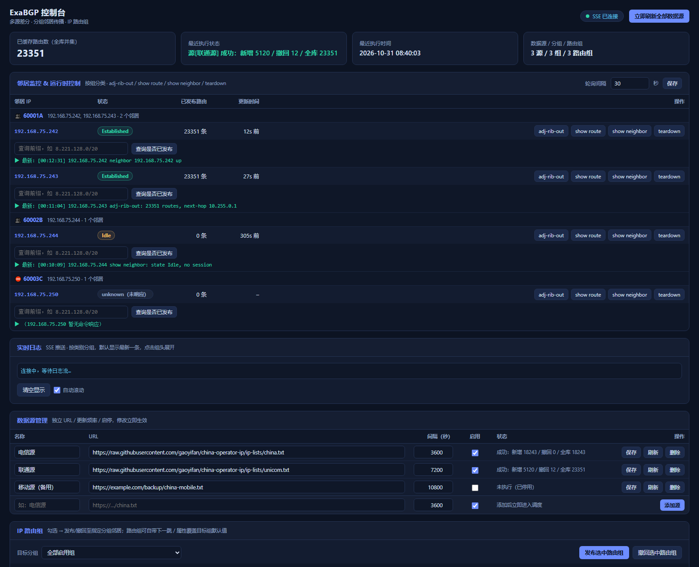

# 控制台使用手册

控制台是单文件页面（`src/index.html`），随镜像发布，地址：`http://<宿主机IP>:9550/index.html`。



页面自上而下分 8 个区块，下面按区块说明。

---

## 1. 顶部状态栏

| 元素 | 说明 |
|---|---|
| **SSE 已连接 / 断开重连中** | 实时日志通道状态。断开时页面每 3 秒自动重连，不影响其他面板 |
| **立即刷新全部数据源** | 把所有源的 `next_due` 置 0，立刻触发一轮拉取（等价 `POST /refresh`） |
| **☀ / 🌙** | 深色 / 浅色主题切换，选择保存在浏览器本地；首屏加载前就会应用，不会闪一下 |

## 2. KPI 概览

| 卡片 | 含义 |
|---|---|
| 已缓存路由数（全库并集） | 所有启用源的路由并集，实际会播给 CE 的条数 |
| 最近执行状态 | 最近一次源刷新的结果（成功：新增 X / 撤回 Y / 全库 Z；失败会红字） |
| 最近执行时间 | 该次刷新的时间（容器时区） |
| 数据源 / 分组 / 路由组 | 三类对象的数量概览 |

## 3. 邻居监控 & 运行时控制

按**分组**分块展示邻居，每个邻居一行：

```
邻居 IP | 状态 | 已发布路由 | 更新时间 | 操作(adj-rib-out / show route / show neighbor / teardown)
查询前缀 [输入框] [查询是否已发布] ✅/❌ 结果
▶ 最新: [HH:MM:SS] 命令回显（点击展开最近 10 条）
```

- **状态**：`Established` 绿色；`Idle/Active/…` 琥珀色；`unknown（未响应）` 灰色。
- **已发布路由**：该邻居 `adj-rib-out` 的条数（由 `show adj-rib out` 解析）。
- **轮询间隔**：右上角输入框，5~3600 秒，保存后立即生效（重启回落到 `NEIGHBOR_POLL_INTERVAL`）。
- **查询前缀**：输入 `1.0.1.0/24` 点查询，判断该前缀是否已发布到该邻居；结果按邻居缓存，5 秒刷新不丢。
- **命令回显**：默认只显示最新一条，点击展开该邻居最近 10 条响应。

四个命令按钮对应 exabgp 的运行时控制：

| 按钮 | 实际命令 | 用途 |
|---|---|---|
| `adj-rib-out` | `show adj-rib out` | 看已发布路由明细 |
| `show route` | `show adj-rib out`（exabgp 4.x 无 `show route`） | 同上，兼容旧习惯 |
| `show neighbor` | `show neighbor` | 会话参数/统计 |
| `teardown` | `teardown` | 拆会话触发重连（慎用） |

## 4. 实时日志

- 日志按类别分组：📢 发布 / 🗑️ 撤回 / 📡 数据源 / 🧩 分组 / 📦 路由组 / ⌨️ 命令 / 👁️ 邻居 / ⚙️ 配置 / 🛠 系统。
- 每组默认**折叠**，只显示"最新一条"预览；点组头展开全部（最多保留 500 条，超出滚动）。
- 「清空显示」只清浏览器侧，"自动滚动"控制是否跟随最新日志。

## 5. 数据源管理

| 列 | 说明 |
|---|---|
| 名称 | 便于识别的标签 |
| URL | 必须是 http(s) 直链（每行一个前缀），私有地址请用网关代理 |
| 间隔（秒） | 该源的更新频率，最小 10 |
| 启用 | 停用后不再参与并集，也不会被拉取 |
| 状态 | 最近一次结果与时间（悬停可看"本源 X 条"） |
| 操作 | 保存（改完必须点）/ 刷新（立即拉一次）/ 删除 |

底部一行是"添加源"，填完点「添加源」立即进入调度。

> 多源的价值：把"电信 / 联通 / 移动 / 自定义段"拆成独立源，各自频率与启停，互不干扰。

## 6. IP 路由组

用于**临时/批量**下发一批不来自数据源的网段（例如某个业务的 VIP 段）。

| 列 | 说明 |
|---|---|
| 选择 | 勾选后点上方「发布选中路由组 / 撤回选中路由组」 |
| 名称 | 如 `office365` |
| 前缀数 | 组内前缀条数 |
| 下一跳 / 属性 / MED / Prepends | **覆盖项**，留空或 0 = 跟随目标分组 |
| 操作 | 列表（弹窗逐条增删改）/ 保存 / 删除 |

- 顶部「目标分组」决定发往哪些邻居；默认"全部启用组"。
- 添加行下方的前缀列表**必填**，每行一个，也支持 `url` 字段从 URL 导入（REST）。
- 路由组的属性只在**发布时**生效——改完属性需要重新点一次「发布选中路由组」。

**前缀列表弹窗**：支持搜索、逐条改/删、单条新增，改动立即落盘。

## 7. 分组邻居传播

一个分组 = 一个客户/站点的一组邻居 + 统一属性。

| 列 | 说明 |
|---|---|
| 组名 | 建议 `客户ID+站点号`（如 `60001A`），仅作标识与 description |
| 邻居 IP | 逗号分隔多个，每个 IP 生成一个 `neighbor` 声明块 |
| 下一跳 | 该组路由的 next-hop |
| 属性 community | 如 `65000:100`，可空格分隔多个 |
| MED | 可选，0~4294967295；留空 = 不携带 MED |
| Prepends | 0~10，AS-PATH 中本地 AS 的额外重复次数 |
| 启用 | 停用会自动从该组邻居撤回全库 |
| 操作 | 保存 / 删除 |

> **保存即生效**：改下一跳 / community / MED / Prepends 后，引擎会对该组**重播全库**（因为已下发的路由不会自动带上新属性）；改邻居 IP 或启停会重建 `exabgp.conf` 并热重载。

## 8. 手动发布 / 撤回

左栏：

1. 选「目标分组」（或"全部启用组"）；
2. 可直接粘贴前缀，或用「路由组载入」把某组前缀灌进输入框；
3. 「发布」/「撤回」，结果在下方「下发记录」按目标分组展开，含 next-hop/属性/前缀明细。

右栏「运行时参数快照」只读：BATCH_SIZE、调度周期、最小间隔、分组邻居一览、路由组一览，用于核对"配置是否真的生效"。

---

## 9. 操作速查

| 我想…… | 操作 |
|---|---|
| 看某网段有没有发出去 | 邻居行"查询前缀"，或 `GET /api/adjrib?ip=&prefix=` |
| 临时给某业务加一段路由 | IP 路由组 → 添加 → 勾选 → 发布 |
| 把所有源立即刷新一遍 | 右上角「立即刷新全部数据源」 |
| 让某组变成备份路径 | 该组 `Prepends` 填 2~3，保存（自动重播） |
| 主备用 MED 区分 | 主组 MED=100、备组 MED=200（需同前缀多路径才生效） |
| 停掉某个客户的路由 | 取消该组「启用」→ 保存（自动撤回全库） |
| 改完样式看不到变化 | `Ctrl + F5` 强制刷新（服务端已发 `no-cache`） |
| 白天屏幕太亮 / 投屏发灰 | 右上角 ☀ / 🌙 切换深浅主题（会记住） |

## 10. 操作护栏与状态提示

为防止误操作，控制台对以下行为加了护栏：

| 操作 | 护栏 |
|---|---|
| 删除数据源 / 分组 / 路由组 | 弹确认框，列出**影响**（本源条数、将向几个邻居撤回多少条），并要求**输入名称**才能确认 |
| 拆断 BGP 会话（teardown） | 确认框 + 输入邻居 IP |
| 撤回路由（手动 / 路由组） | 确认框显示将撤回的前缀条数 |
| 保存分组属性（next-hop / community / MED / prepend） | 提示"将对该组**重播全库 N 条**"，确认后才提交 |
| 所有提交类按钮 | 执行期间禁用并显示"处理中…"，避免连点重复下发 |
| 每次操作结果 | 右下角 toast；失败时直接显示后端返回的错误原因 |

顶部**异常横幅**会自动汇总当前问题（无需翻日志）：

- 实时日志通道（SSE）断开；
- 某个数据源最近一次抓取失败；
- 有 BGP 邻居未建立会话（列出 IP 与状态）。

**搜索与排序**：右上角搜索框可按组名 / IP / 前缀 / URL 过滤三张表；表头（名称、间隔、前缀数）可点击排序。

> 「已发布路由」列显示 `—` 表示**未采集到 adj-rib-out 明细**（不是 0 条）；点该行的 `adj-rib-out` 可查看实际发布表。

## 11. 下发预演 / 前缀预检 / 导出 / 配置预览

**下发预演（dry-run）**：点「发布」不再直接下发，先弹「下发预览（未执行）」——

```
目标分组 2 个 · 路由 128 条 · 生成命令 256 条
前 5 条命令预览：
neighbor 192.168.75.241 announce route 13.107.6.0/24 next-hop 192.168.75.244 community [65000:100]
…
```

确认后才真正写管道；取消则什么都不发生。路由组发布同理。

**前缀预检**：手动发布或新增路由组时，粘贴的前缀会先本地校验：

```
输入 5 行：合法 3，非法 1，重复 1。
✗ bad-line
↺ 13.107.6.0/24（重复）
将只提交合法的 3 条。
```

可以选择「仅提交合法项」或取消；全非法时直接拒绝。

**导出**：

- 路由组前缀弹窗 →「导出 CSV」（文件名 `<组名>-prefixes.csv`）
- 操作审计弹窗 →「导出 CSV」（时间/操作者/IP/动作/目标/结果/明细）
- CSV 带 BOM，Excel 直接打开不乱码

**配置预览 / 漂移检测**：点右上角「配置」——

- 一致时：显示"✅ 磁盘上的 exabgp.conf 与当前配置一致"，并展示全文（可复制）；
- 不一致时：显示"⚠️ 检测到配置漂移"，用 diff 视图标出增删行（`+` 绿、`-` 红、`@@` 蓝）。

对比时会忽略自动生成的时间戳注释，所以正常情况下应显示"一致"；出现漂移通常意味着有人手改了 `exabgp.conf`，或者磁盘文件与内存配置未同步。

> 路由组前缀列表默认只渲染 200 条，底部有「加载更多」，避免几万条前缀把浏览器卡死。

## 12. 操作审计与访问令牌

**审计**：点右上角「审计」查看最近 200 条写操作记录（时间 / 操作者 / 来源 IP / 动作与目标 / 结果），支持按操作者、动作、目标过滤；鼠标悬停在"动作"上可看参数明细（JSON）。

记录落在 `/exabgp/data/audit/audit-YYYY-MM-DD.jsonl`，一行一条，可直接 grep 或导入日志系统。

**访问令牌**：服务端配置 `API_TOKEN` 后，页面会弹出令牌输入框；令牌保存在浏览器 localStorage，可通过右上角 🔑 修改或清除。

- `API_TOKEN`：读写权限
- `VIEWER_TOKEN`：只读权限（所有写按钮点击后会被服务端拒绝并提示）

未配置 `API_TOKEN` 时不鉴权（与旧版行为一致），适合内网单机部署。

## 13. 已知限制
- 控制台没有登录/鉴权，默认谁都能改——请只在受控网络暴露。
- 一次只支持一个浏览器会话做"编辑"；多人同时改会以最后一次保存为准。
- 状态刷新是 10 秒轮询 + SSE，不是实时推送每一条（日志是实时的）。
