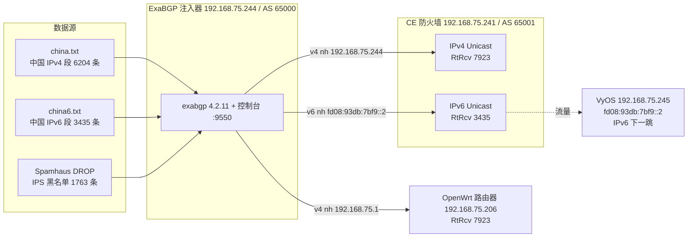

# 测试拓扑与验证用例

一套**已完整跑通**的 IPv4 / IPv6 双栈注入环境，可作为自建验证的参考。
涉及的产品能力见 [选路属性](routing-attributes.md)，控制台操作见 [控制台手册](console.md)。



## 设备与地址

| 角色 | 地址 | AS | 说明 |
|---|---|---|---|
| ExaBGP 注入器 | `192.168.75.244` | 65000 | Ubuntu + Docker，BGP 会话发起方 |
| CE 防火墙 | `192.168.75.241` | 65001 | 华为 USG，`Vlanif75`，同时跑 v4/v6 地址族 |
| CE 的 IPv6 地址 | `fd08:93db:7bf9::241/64` | — | 早期误用 `::1` 触发 DAD 冲突，见下方"踩坑" |
| IPv6 下一跳设备 | `fd08:93db:7bf9::2` | — | VyOS，`eth0` 同网段 |
| OpenWrt 路由器 | `192.168.75.206` | 65001 | 只收 v4，下一跳 `192.168.75.1` |

## 数据源与分组

| 数据源 | 条数 | 绑定分组 |
|---|---|---|
| china.txt（中国 IPv4 段） | 6204 | 默认组、60001A |
| china6.txt（中国 IPv6 段） | 3435 | IPv6-CHINA |
| Spamhaus DROP（IPS 黑名单） | 1763 | 默认组、60001A |

| 分组 | 邻居 | 下一跳 | community |
|---|---|---|---|
| 默认组 | `192.168.75.241` | `192.168.75.244` | `65000:100` |
| 60001A | `192.168.75.206` | `192.168.75.1` | `65000:100` |
| IPv6-CHINA | `192.168.75.241` | `fd08:93db:7bf9::2` | `65000:100` |

> 注意：v4 与 v6 用的是**同一个 BGP 会话**（MP-BGP 多地址族），不是两条会话。

## 验证结果

CE 侧：

```
display bgp all summary
 Address Family:Ipv4 Unicast   Established   RtRcv 7923    ✅
 Address Family:Ipv6 Unicast   Established   RtRcv 3435    ✅

display ip routing-table           → 7923 条 BGP，下一跳 192.168.75.244
display ipv6 routing-table         → Destinations 3441，其中 3435 条 Protocol : EBGP
                                     下一跳 FD08:93DB:7BF9::2，Flags : RD（已下发 FIB）
```

注入器侧：

```
show adj-rib out → v4 7923 条 + v6 3435 条，各族下一跳互不串用
```

## 踩坑清单（都已在代码/文档里修掉）

| 现象 | 原因 | 处理 |
|---|---|---|
| 容器起不来：`incomplete neighbor, missing local-address` | IPv6 邻居必须配同族 `local-address` | 分组里"本地地址"填 IPv6（可先填 `::`） |
| v6 路由 `RtRcv` 有数但 `adj-rib-out` 里 0 条 | CE 未启用 `ipv6-family`；exabgp 4.2.11 无 extended-nexthop 能力 | CE 加 `ipv6-family unicast` + `peer x enable` |
| v4 前缀的下一跳变成 IPv6 | v4 数据源未绑定分组，流进了 IPv6 组并被覆盖 | 给数据源显式绑定分组（v4 源绑 v4 组） |
| CE `ping ipv6` 不通同网段地址 | CE 地址 `[DUPLICATE]`，DAD 检测到冲突后全局地址失效 | 换一个未占用地址（`::241`）；见 [选路属性 §8.1](routing-attributes.md) |
| 路由收到却不进路由表 | 下一跳解析失败（不可达） | 确认下一跳地址在 CE 侧可达，必要时加静态 `/128` |

## 复现步骤

1. 注入器按 [部署指南](deployment.md) 起容器，`--network host` + 挂载 `/exabgp/data`
2. 控制台里建分组（邻居 / 下一跳 / community），建数据源并**绑定分组**
3. CE 侧按 [选路属性 §8.1](routing-attributes.md) 配 BGP 与 IPv6 地址族
4. 逐项核对上面的「验证结果」，任何一项对不上就查「踩坑清单」
